# GAN With CNN Hybrid 16

A compact, notebook-based project focused on combining Generative Adversarial Networks (GANs) with Convolutional Neural Networks (CNNs) for image generation and feature learning.

This repository contains a Jupyter Notebook implementation that demonstrates the workflow for building, training, and evaluating a hybrid GAN-CNN model. It is intended as a learning and experimentation project.

## Live motion: latent particles to generated images

The animated diagram below visualizes the GAN workflow: fixed latent inputs flow through the generator, while the discriminator provides adversarial feedback. It is an illustrative animation—not a live view of notebook training or evidence of model quality.



If your Markdown viewer does not animate SVGs, open [`docs/gan-motion-particles.svg`](docs/gan-motion-particles.svg) directly. For the training-checkpoint visual-story guide, see [`docs/MOTION_VISUALIZATION_ARTICLE.md`](docs/MOTION_VISUALIZATION_ARTICLE.md).

## Overview

Generative Adversarial Networks learn data distributions and generate samples. CNN layers help capture spatial patterns and local structure in image data. This project explores their use together in an adversarial image-generation workflow.

This project is intended for:

- learning hybrid GAN + CNN architecture design
- experimenting with image generation workflows
- understanding adversarial training dynamics
- visualizing generated outputs during training

## Repository Contents

- `GAN_With_CNN_HYBRID16.ipynb` — the main notebook containing the implementation, training code, and experiment flow.
- `docs/MOTION_VISUALIZATION_ARTICLE.md` — a storyboard and guide for interpreting generated-image checkpoints.
- `docs/gan-motion-particles.svg` — an animated, illustrative particle diagram of the GAN workflow.

## Key Features

- CNN-based feature extraction
- GAN architecture with generator-discriminator training
- Notebook-driven experimentation
- Image generation and output visualization
- Easy adaptation for custom datasets

## Suggested Workflow

1. Open the notebook in Jupyter Notebook or JupyterLab.
2. Install the required Python dependencies.
3. Load your dataset or use the embedded example workflow.
4. Run the cells in sequence to train the hybrid model.
5. Analyze discriminator/generator loss and generated sample quality.

## Requirements

A typical environment includes:

- Python 3.9+
- Jupyter Notebook or JupyterLab
- NumPy
- Matplotlib
- TensorFlow or PyTorch (depending on the notebook implementation)

Example installation:

```bash
pip install notebook numpy matplotlib
```

If the notebook uses TensorFlow or PyTorch, install the framework version required by your environment:

```bash
pip install tensorflow
```

or

```bash
pip install torch torchvision
```

## Run the Project

```bash
jupyter notebook GAN_With_CNN_HYBRID16.ipynb
```

Then execute the notebook cells in order.

## Project Goal

This project explores a practical hybrid approach where CNN layers learn meaningful visual features and adversarial training drives image generation. Results depend on the dataset, model configuration, and training process.

## Notes

- The notebook is designed for experimentation and learning.
- Hyperparameters such as learning rate, batch size, latent dimension, and epochs can be tuned.
- Datasets can be replaced or extended depending on your target domain.
- The README animation is a conceptual illustration; it does not connect to a running training session.

## License

This project currently does not include a repository license file. If you plan to share or distribute it publicly, consider adding an appropriate open-source license.

## Author

Created and maintained by `saravanavel07`.
